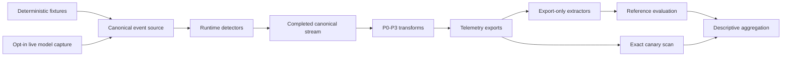
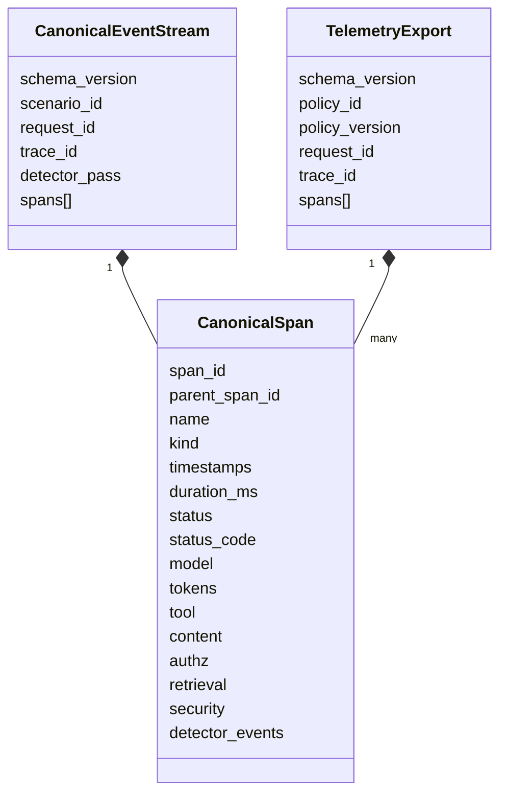
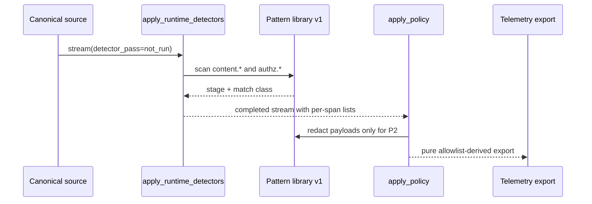
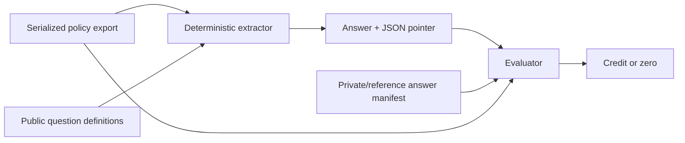
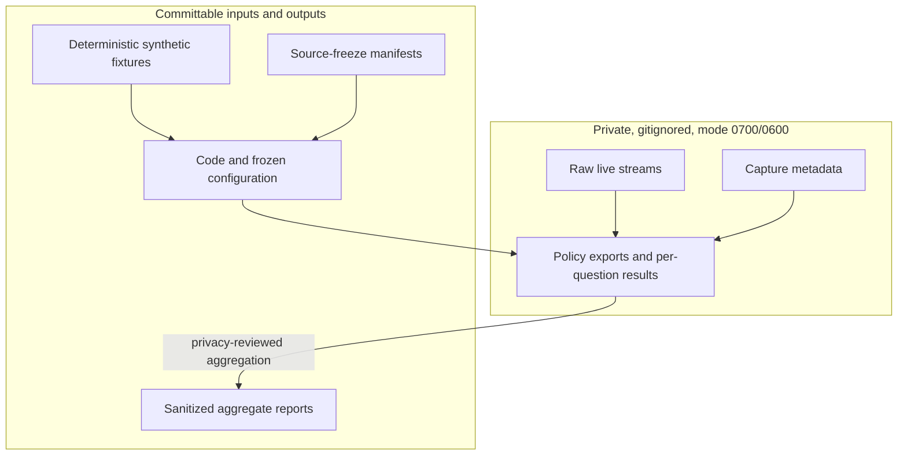

# Code architecture

This repository implements a paired experiment for measuring the privacy and
forensic utility of GenAI telemetry. It captures or constructs one complete
runtime event stream, runs detectors once, and derives four policy exports from
that same stream. Deterministic graders then measure what an investigator can
reconstruct and whether registered synthetic canaries appear in an export.

The implementation is deliberately split into a reusable telemetry core and
three experiment layers:

1. the implementation pilot (`validation` and `grading`),
2. the research-feasibility workflow (`research`), and
3. the current full study (`full_study`).

The full study reuses the core instead of defining a separate telemetry model,
detector, or policy transform.

## System context



The model is called during capture, never once per policy. This makes every
P0-P3 comparison paired: the policies see the same realized model and tool
behavior.

## Repository layout

```text
src/genai_observability/
  schemas/       Versioned canonical-stream, span, export, and allowlist models
  serialization.py
                 Canonical JSON and SHA-256 identity
  patterns/      Versioned pattern-library loading, scanning, and redaction
  runtime/       Pre-transform detector pass
  transforms/    Pure P0-P3 allowlist transforms
  sources/       Canonical-event source interface and fixture implementation
  grading/       Pilot Q1-Q15 extraction, evidence checks, evaluation, exposure
  validation/    Implementation-pilot runner, predictions, and provenance
  research/      Feasibility R1-R7 capture, replay, grading, and safeguards
  full_study/    FS1-FS16 + OC1 scenarios, capture, replay, grading, aggregation

policies/
  allowlists/    Published P0-P3 field actions
  pattern_libraries/
                 Detector/redaction pattern library v1

fixtures/        Public deterministic canonical streams
references/      Answer manifests, canary inventories, and source freezes
validation/      Committable validation and aggregate reporting artifacts
private/         Gitignored live captures, exports, extractions, and results
tests/           Unit, integration, isolation, integrity, and security tests
```

`genai_observability.paths` is the central path registry. Experiment modules
use those constants instead of independently constructing repository paths.

## Core data model

Pydantic models use `extra="forbid"`, reject non-finite numbers, and reject
telemetry keys that could encode fixture labels or expected conclusions.



### Canonical stream

`schemas.canonical.CanonicalEventStream` is the full internal runtime record.
It includes `scenario_id`, which is useful before export, and a
`detector_pass` state with two values:

- `not_run`: detector results are not trustworthy yet;
- `completed`: every span has a detector-event list, including an empty list
  when the detector ran and found no match.

### Span model

`schemas.span.CanonicalSpan` is shared by canonical streams and exports. Its
optional nested groups include:

- model identity and token counts,
- tool identity,
- raw content,
- raw authorization context,
- retrieval identifiers,
- structured security fields, and
- detector events without raw matched values.

Transforms omit dropped groups rather than serializing them as `null`.

### Export envelope

`schemas.export.TelemetryExport` contains the public request and trace identity,
the policy identity/version, and transformed spans. It intentionally excludes
`scenario_id` and `detector_pass`.

## Canonical serialization and identity

`serialization.py` defines the artifact identity used throughout the project:

- UTF-8 JSON,
- keys sorted recursively by `json.dumps`,
- compact separators,
- `ensure_ascii=False`,
- absent optional values omitted,
- non-finite numbers rejected, and
- SHA-256 over the resulting bytes.

Hashes are used for fixtures, processed streams, exports, capture packages,
source freezes, and replay artifacts. Code that needs artifact identity calls
`canonical_json_text`, `canonical_json_bytes`, `sha256_hex`, or
`canonical_hash`; it does not maintain an alternate serialization format.

## Detector and redaction pipeline



`runtime.detectors.apply_runtime_detectors` is the only operation that marks a
stream completed. It replaces any supplied detector events and records only
detector ID, category, stage, and match class. It never writes answer labels or
raw matches.

`patterns.scan` serves both detection and P2 redaction. It recursively handles
strings, lists, dictionaries, and dictionary keys. Redacted dictionary keys are
assigned deterministically, and collisions receive the next free `_N` suffix so
entries cannot overwrite one another.

`transforms.apply.apply_policy` refuses a stream whose detector pass is not
completed. It is pure with respect to its input and does not rerun detectors.

## Policy transforms

The policy files under `policies/allowlists` enumerate an action for every field
in the experiment contract. `schemas.allowlist.PolicyAllowlist` validates that
the matrix is complete.

| Policy | Core behavior |
| --- | --- |
| P0 | Retains APM metadata, topology, request identity, and status. Drops content, detector events, raw authz context, retrieval identity, and security enums. |
| P1 | Adds raw content, raw authz context, retrieval identity, and detector events. Drops P3 security enums. |
| P2 | Uses the P1 surface but applies pattern-library redaction to `content.*` and `authz.*`. |
| P3 | Adds structured trust, privilege, authorization, denial, opaque retrieval identity, and detector events. Drops raw content and raw authz context. |

Opaque retrieval identifiers use `sha256:` followed by the SHA-256 digest of
the source identifier. They support correlation but are not treated as proof of
anonymity.

## Source abstraction

`sources.base.CanonicalEventSource` defines the interface for producing a
canonical stream. `FixtureSource` loads deterministic JSON and always resets
`detector_pass` to `not_run`, preventing a fixture from bypassing runtime
detection. `CapturedTraceSource` reserves the extension point for trace-backed
sources.

The full-study capture adapter currently constructs the same canonical schema
directly from model, retrieval, authorization, and local tool activity. A future
OTLP or vendor trace importer should terminate at this interface or produce a
`CanonicalEventStream`; downstream detectors, policies, and graders should not
need to change.

## Extract-then-evaluate grading

The grading boundary prevents reference answers from becoming evidence.



The extractor receives the export and public selectors only. It returns an
answer with one or more JSON pointers, or `missing`/`ambiguous`. The evaluator
loads the answer manifest afterward, checks the value, and verifies that every
credited pointer resolves in the serialized export artifact.

The repository contains three versioned question sets:

- `grading`: pilot Q1-Q15,
- `research`: feasibility R1-R7, and
- `full_study`: FS1-FS16 plus OC1.

Each layer has its own `questions`, `extract`, `evaluate`, `references`, and
selection logic. They share the evidence-pointer types and resolution helpers in
`grading.evidence`.

`grading.exposure.grade_exposure` is independent of forensic scoring. It scans
only the serialized policy export for exact registered canary substrings.
Zero-canary executions are non-applicable rather than `0/0`.

## Full-study scenario model

`full_study.scenarios` is the frozen registry. It defines six intended families,
matched case/control pairs, source type, prompts, retrieval inputs, router
permissions, and any pre-model canary placement. Identifiers do not encode an
answer.

`full_study.surface` implements the deterministic local application surface:

- a note catalog and retrieval selector,
- the `get_note` and `delete_account` tools,
- authorization routing,
- privilege classification, and
- system instructions.

Tools have no external side effects. Realized tool use still depends on the
model; absent, malformed, denied, or unexpected tool behavior is preserved
rather than replaced with a preferred execution.

`full_study.select` derives answer manifests and applicability from the realized
canonical stream, before policy transformation. `full_study.inventory` derives
the canary inventory from the frozen planting and realized stream.

## Full-study execution paths

### Mocked retention validation

`python -m genai_observability.full_study.runner`

The mocked runner handles all 48 registered case/control executions, refuses
both live environment flags, and writes 192 P0-P3 exports when successful. It
compares actual scores with retention forecasts. These results validate the
implementation and allowlists; they are not live-model research evidence.

### Opt-in live capture

`python -m genai_observability.full_study.live_capture`

The live entry point handles only the 24 capture-once executions. Before a
client is constructed or a request is sent, it requires:

1. `GENAI_FULL_STUDY_LIVE=1`,
2. an API key,
3. a current and internally consistent official-document check,
4. an exact source-freeze match, and
5. the frozen model and budget configuration.

`full_study.live_adapter.FullStudyCaptureAdapter` enforces the gates again at
the final send boundary. It validates response shape, tool arguments, request
accounting, the request cap, estimated input bound, and dollar ceiling. Every
attempted execution is persisted incrementally, including partial and failed
records. The low-level HTTP transport is imported lazily only by an authorized
live client.

### Offline live-capture replay

`python -m genai_observability.full_study.replay_live_capture --capture-dir <dir>`

The replay command has no capture or retry path. It refuses live environment
flags and, before creating output, verifies:

- the capture directory is a regular, symlink-free tree,
- the artifact manifest covers every file with no extras or omissions,
- every artifact digest matches,
- the recorded capture source freeze is consistent,
- current detector, transform, grader, schema, registry, and policy sources
  match the replay-analysis freeze,
- all 24 executions completed without failed, partial, truncated, stopped, or
  unattempted records, and
- the destination cannot overlap the immutable capture tree.

Verified capture bytes are snapshotted in memory and become the only replay
input. The replay uses completed processed streams, regenerates references and
inventories, applies P0-P3, extracts, evaluates, grades exposure, and writes a
new owner-only run directory. Unexpected failures preserve a private structural
failure record without printing raw capture content.

## Privacy and trust boundaries



Private persistence uses `secure_capture_directory` and
`secure_capture_write_text`:

- directories are owner-only (`0700`),
- files are owner-only (`0600`),
- writes use `O_NOFOLLOW` when available,
- destinations are checked against a root boundary, and
- explicit nonempty run directories are rejected.

Live capture output, answer excerpts, policy exports, and per-question results
remain under `private/`. Public reporting is generated from sanitized aggregate
data rather than direct reads of raw captures.

## Provenance and artifact layout

Every experiment run has a unique destination and records enough provenance to
identify its inputs. Depending on the workflow, this includes:

- Git commit, describe string, and dirty state,
- per-file and combined hashes for package sources,
- policy allowlist and pattern-library hashes,
- fixture, answer, and canary hashes,
- capture input/configuration hashes,
- raw, processed, export, and result hashes, and
- an artifact manifest for immutable capture/replay packages.

The normal data progression is:

```text
raw canonical stream
  -> processed canonical stream
  -> P0/P1/P2/P3 export
  -> extraction
  -> evaluation + exposure result
  -> execution-level record
  -> aggregate summary
```

Capture packages and replay packages keep these stages separate so a reviewer
can verify identities and failure state without treating one artifact as
another.

## Aggregation

`full_study.aggregate.summarize` computes descriptive means by policy, source,
family, and question category. It reports exposure separately, including
executions with any exposure, exposure origins, and zero-canary executions.

`paired_differences` compares policies within the same execution. Case/control
differences are constructed by the replay layer within a registered pair. The
exploratory bootstrap is explicitly non-primary and reports an unavailable
interval when too many resamples lack eligible exposure strata.

## Failure semantics

Failures are data, not an instruction to recapture until a desired result
appears.

- A detector or source failure prevents that execution from reaching policy
  transformation.
- A transform or grader failure preserves the stream and excludes only the
  failed policy result.
- No-tool, denied-tool, malformed-tool, unexpected wording, and no-copy behavior
  are retained as realized observations when a usable canonical stream exists.
- Budget, request-cap, input-bound, and malformed-response failures persist
  partial structural evidence and stop according to the frozen protocol.
- The live study is never automatically retried as a complete study.

## Testing strategy

The tests are organized by invariant rather than mirroring individual helper
functions. Major groups cover:

- strict schema validation and canonical serialization,
- allowlist completeness and transform behavior,
- detector/redaction consistency and collision handling,
- missing versus empty detector-event representation,
- extractor isolation from answers, filenames, and fixture IDs,
- serialized JSON-pointer evidence resolution,
- exposure scan boundaries and zero-canary handling,
- scenario/reference selection and applicability,
- capture retries, truncation, malformed arguments, budgets, and persistence,
- live authorization and source-freeze gates,
- immutable replay, path/symlink protection, permissions, and failure status,
- descriptive aggregation and retention forecasts.

Run the complete suite with:

```bash
.venv/bin/python -m pytest
```

## Extension points

### Add a canonical-event source

Implement `CanonicalEventSource` or construct a valid
`CanonicalEventStream`. Leave `detector_pass=not_run`; the shared runtime pass
must remain the only producer of completed detector state.

### Add a policy version

Add a complete versioned allowlist, extend `PolicyId` only if introducing a new
policy identity, and add transform/forecast tests. Do not branch detector
instrumentation by policy.

### Add detector patterns

Version the pattern library and use the same library for runtime detection and
P2 redaction. Detector events must remain structural and must not include raw
matches or answer labels.

### Add a question set

Define public question IDs/selectors separately from reference answers. Keep
extraction export-only, require evidence pointers for credit, and load private
expected values only in evaluation.

### Import real observability traces

Map external trace records into the canonical schema at the source boundary.
Preserve span identity and topology, record the source/version in provenance,
and reuse the existing detector, transform, extraction, and evaluation stages.

## Architectural invariants

Changes should preserve these properties:

1. Runtime instrumentation is policy-independent.
2. Detectors run exactly once before policy transforms.
3. Policy transforms are pure, deterministic, and allowlist-driven.
4. Canonical JSON has one implementation and one hashing rule.
5. Extractors cannot access answer manifests or canary inventories.
6. Forensic credit requires an answer and resolvable export evidence.
7. Exposure scans only the serialized policy export.
8. Applicability comes from the realized canonical stream, not a policy export.
9. Live network access is isolated behind explicit gates and a lazy transport.
10. Partial and failed runs are preserved and cannot report success.
11. Raw live artifacts stay private; public reporting uses sanitized aggregates.
12. One captured execution is replayed through every policy being compared.
